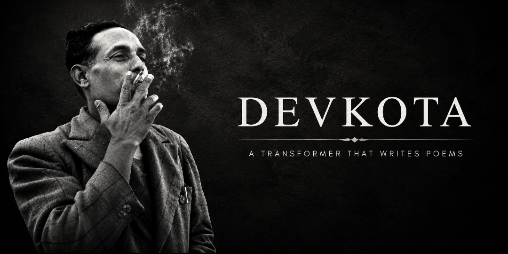

# Devkota

**A small language model for Nepali poetry.**

Devkota is an experiment in teaching a decoder-only Transformer the sound and movement of Nepali text, then giving it a few explicit poetic constraints to work with. The model learns from token sequences; a separate rule-guided generator can encourage rhythm, rhyme, recurring themes, and line breaks. The rules make the experiment more legible, but they do not make a poem correct by themselves. Prosody is subtle, and the quality of the result still depends on the corpus, the model, and a reader’s judgment.

The active implementation is in [`devkota-v0.7`](devkota-v0.7/). Older iterations are kept under [`archives`](archives/).

## How it works

The model is a GPT-2-style decoder: token and positional embeddings pass through causal self-attention blocks, and a language-model head predicts the next token. It is trained first on a broader Nepali text corpus, then fine-tuned on poems. At generation time, you can sample freely or ask the poem generator to score candidate lines against simple poetic rules.

The main pieces are:

- `devkota-v0.7/src/devkota.py` defines the model.
- `embedding.py`, `mha.py`, `layerNorm.py`, and `decoderBlock.py` implement its building blocks.
- `tokenizer.py` trains or loads the SentencePiece tokenizer; the trained model and vocabulary are in `devkota-v0.7/tokenizer/`.
- `data.py` prepares text as token streams and samples training batches.
- `train.py` handles pretraining, fine-tuning, evaluation, and checkpoints.
- `poetry.py` contains the optional line-scoring and poem-generation rules.
- `devkota-v0.7/main.py` is the command-line entry point.

## Get started

From the repository root, install the Python dependencies:

```bash
python -m pip install torch numpy sentencepiece
```

The tokenizer is already included. The training text and checkpoints are not. Put the corpus files in the following layout (the default `--data-dir` is `data/` at the repository root):

```text
data/
├── merged/
│   ├── train_merged.txt
│   └── validation_merged.txt
└── preprocessed/
    └── poem.txt
```

Then prepare the token files:

```bash
python devkota-v0.7/main.py prepare
```

This writes `train.bin`, `val.bin`, and `poem.bin` under `data/tokens/`. Each non-empty line is tokenized; general-corpus lines are separated by an end-of-sequence token, while poem lines are separated by a newline token.

## Train

Pretrain on the broader corpus, then fine-tune on the poem text:

```bash
python devkota-v0.7/main.py pretrain
python devkota-v0.7/main.py finetune
```

The default model is intentionally modest: 6 layers, 4 attention heads, a 256-wide hidden representation, and a 128-token context. Training defaults to CUDA when PyTorch detects it; use `--device cpu` to select the CPU explicitly. Checkpoints are written to `devkota-v0.7/checkpoints/` by default. Useful options include `--steps`, `--batch-size`, `--eval-every`, `--ckpt-dir`, and `--data-dir`:

```bash
python devkota-v0.7/main.py pretrain --steps 5000 --batch-size 16 --device cuda
python devkota-v0.7/main.py finetune --init-from devkota-v0.7/checkpoints/pretrain.pt
```

Training saves a best-validation checkpoint and a rolling `*_last.pt` checkpoint. Pass `--resume` to continue from the rolling checkpoint for that training stage.

## Generate

Generate a poem with the rule-guided mode:

```bash
python devkota-v0.7/main.py generate --prompt "हिमाल" --lines 8 --rhyme AABB
```

You can set a metre by name or supply a light/heavy pattern, and you can guide the subject with comma-separated theme words:

```bash
python devkota-v0.7/main.py generate --prompt "हिमाल" --metre panchachamar --metre-tolerance 1 --rhyme ABAB --theme "हिमाल,जून" --candidates 24 --verbose
```

For unconstrained next-token sampling, use `--raw`:

```bash
python devkota-v0.7/main.py generate --prompt "हिमाल" --raw --max-tokens 200
```

Generation expects a fine-tuned checkpoint at `devkota-v0.7/checkpoints/devkota_poet.pt`. Select another with `--ckpt path/to/model.pt`. Set `--seed` to make sampling repeatable.

## A note on the rules

The generator’s metre and syllable checks are practical approximations based on Devanagari aksharas and light/heavy syllables. They are useful constraints for exploring form, not a complete account of Nepali prosody. Treat generated poems as drafts: listen to the lines, revise them, and let the language lead where a rule falls short.

## Project status

This is a learning and research project, not a general-purpose Nepali language model. Its range and fluency are bounded by the size, quality, and variety of its training text. The corpus is not included in this repository; prepare and review your data before training.
